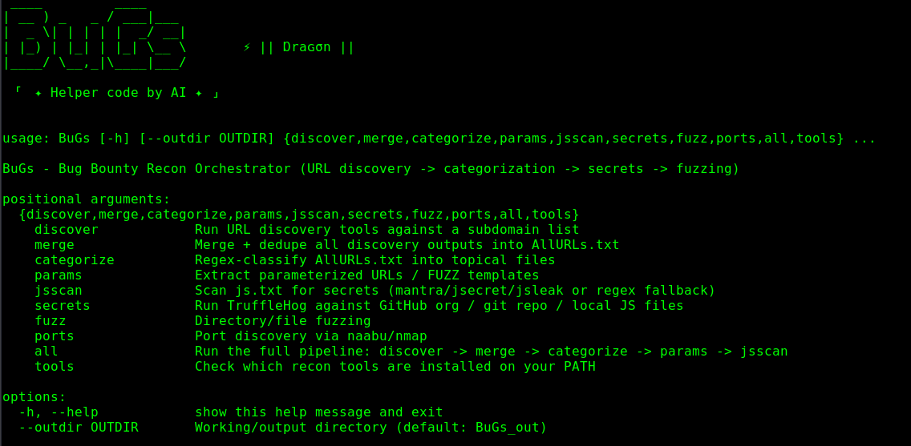

# BuGs

**BuGs** is a bug bounty recon orchestrator. It chains together the URL
discovery → merge → categorize → parameter extraction → JS secret scanning →
directory fuzzing → port discovery workflow that bug bounty hunters normally
run as a pile of separate one-liners, and wraps it in a single command-line
tool with two interchangeable implementations:

- `BuGs.py` — Python version
- BuGs.sh` — pure Bash version

Both do the same thing and produce the same output files, so use whichever
fits your environment.

---



---

## Why

Manually chaining `waybackurls | gau | katana | grep ... | anew` across ten
different tools works, but it's repetitive and easy to mess up. BuGs:

- Calls each external recon tool **only if it's actually installed** —
  nothing fails hard if a tool is missing, it just skips that stage with a
  warning.
- Does all URL **categorization** (JS files, API endpoints, admin panels,
  login flows, file uploads, sensitive files, IDOR targets, cloud-key leaks,
  open-redirect/SSRF-prone params, etc.) with **pure regex** — no external
  dependency required for that stage, so it always works once you have a
  URL list.
- Keeps every intermediate file named the way the original manual workflow
  names them (`AllURLs.txt`, `js.txt`, `api_urls.txt`, `ParamURLs.txt`, ...)
  so you can drop in your own files at any stage.

---

## Pipeline stages

| Stage        | What it does                                                                                                                      | Key tools used (if installed)                                                    |
| ------------ | --------------------------------------------------------------------------------------------------------------------------------- | -------------------------------------------------------------------------------- |
| `discover`   | Pulls known/archived URLs for a target                                                                                            | waybackurls, waymore, gau, gauplus, hakrawler, katana, gospider, paramspider, x8 |
| `merge`      | Dedupes every discovery output into `AllURLs.txt`                                                                                 | — (native)                                                                       |
| `categorize` | Regex-classifies `AllURLs.txt` into topical files (JS, PHP, API, admin, login, uploads, sensitive files, IDOR, cloud leaks, etc.) | — (native, always works)                                                         |
| `params`     | Extracts parameterized URLs and builds `FUZZ`-templated versions                                                                  | qsreplace (optional, has native fallback)                                        |
| `jsscan`     | Scans discovered JS files for hardcoded secrets/endpoints                                                                         | mantra, jsecret, jsleak (falls back to a native regex scan)                      |
| `secrets`    | Scans a GitHub org / local JS for verified secrets                                                                                | TruffleHog                                                                       |
| `fuzz`       | Directory/file brute-forcing against a single target                                                                              | ffuf, gobuster, feroxbuster, dirsearch, dirb                                     |
| `ports`      | Port discovery across a target list                                                                                               | naabu, nmap                                                                      |
| `tools`      | Prints which of the ~25 supported tools are on your `PATH`                                                                        | —                                                                                |
| `all`        | Runs discover → merge → categorize → params → jsscan in one go                                                                    | (all of the above)                                                               |

See [`REQUIREMENTS.md`](REQUIREMENTS.md) for install commands for every tool.

---

## Installation

```bash
git clone https://github.com/0xMohamedHamdi/BuGs.git
cd BuGs
chmod +x BuGs.sh
```

Python version needs only Python 3.8+ (standard library only, no pip
packages required for the script itself). Bash version needs Bash 4+ and
standard coreutils (`grep`, `sed`, `awk`, `sort`).

Then install whichever of the underlying recon tools you want to use — see
[`REQUIREMENTS.md`](REQUIREMENTS.md).

Check what's already available:

```bash
python3 BuGs.py tools
# or
./BuGs.sh -s tools
```

---

## Usage

### Full pipeline

```bash
python3 BuGs.py all -i AliveSubs.txt -d example.com --outdir results
```

```bash
./BuGs.sh -i AliveSubs.txt -d example.com -o results
```

`AliveSubs.txt` is a plain text file of alive subdomains/hosts, one per
line. For a single target, just put one line in it.

### Individual stages

```bash
# Python
python3 BuGs.py --outdir results discover -i AliveSubs.txt -d example.com
python3 BuGs.py --outdir results merge
python3 BuGs.py --outdir results categorize
python3 BuGs.py --outdir results params
python3 BuGs.py --outdir results jsscan
python3 BuGs.py --outdir results secrets --github-org example-org
python3 BuGs.py --outdir results fuzz -u https://example.com -w wordlist.txt --tool ffuf
python3 BuGs.py --outdir results ports -i AliveSubs.txt

# Bash
./BuGs.sh -o results -s discover -i AliveSubs.txt -d example.com
./BuGs.sh -o results -s merge
./BuGs.sh -o results -s categorize
./BuGs.sh -o results -s params
./BuGs.sh -o results -s jsscan
./BuGs.sh -o results -s secrets -g example-org
./BuGs.sh -o results -s fuzz -u https://example.com -w wordlist.txt -t ffuf
./BuGs.sh -o results -s ports -i AliveSubs.txt
```

### Already have your own `AllURLs.txt`?

Skip discovery entirely and just classify it:

```bash
mkdir results
cp AllURLs.txt results/
python3 BuGs.py --outdir results categorize
```

---

## Output

Everything lands in `--outdir`/`-o` (default `BuGs_out/`):

```
AllURLs.txt          all discovered URLs, deduped
js.txt               JavaScript file URLs
php.txt / asp.txt / jsp.txt / jspx.txt / aspx.txt
api_urls.txt         API/JSON/GraphQL/versioned endpoints
backend_files.txt    server-side script files
login_flows.txt      auth/login/OAuth/reset-password URLs
file_uploads.txt     upload/download/file-handling endpoints
admin_panels.txt     admin/dashboard/internal management interfaces
sensitive_files.txt  .env/.git/.sql/.bak/config/backup files
idor_targets.txt     numeric-ID / UUID endpoints for IDOR testing
interesting.txt      open-redirect / SSRF-prone parameters
cloud_leaks.txt      possible AWS/GCP/Azure/token/secret references
params.txt           URLs containing query parameters
param.txt            same, with parameter values stripped
ParamURLs.txt        same, with values replaced by FUZZ
```

Plus stage-specific outputs like `ports.txt`, `ffuf_results.json`,
`trufflehog_results.json`, etc., depending on which stages you ran.

---

## Scope & Legal

BuGs is a recon **orchestrator**, not an exploit tool — it discovers and
classifies URLs and calls other people's tools; it doesn't perform
exploitation. Use it only against assets you own or are explicitly
authorized to test (e.g. an in-scope bug bounty program). You are
responsible for complying with the applicable program rules and local law.

---

## Credits

BuGs wraps and orchestrates these excellent open-source tools (install
instructions in [`REQUIREMENTS.md`](REQUIREMENTS.md)): waybackurls, waymore,
gau, gauplus, hakrawler, katana, gospider, paramspider, x8, anew, qsreplace,
mantra, jsecret, jsleak, TruffleHog, Arjun, sqlmap, Nuclei, Param Miner,
ffuf, gobuster, feroxbuster, dirsearch, dirb, Kiterunner, naabu, nmap,
GitDorker, BFAC — all credit to their respective authors.

## License

Add your preferred license here (MIT).
